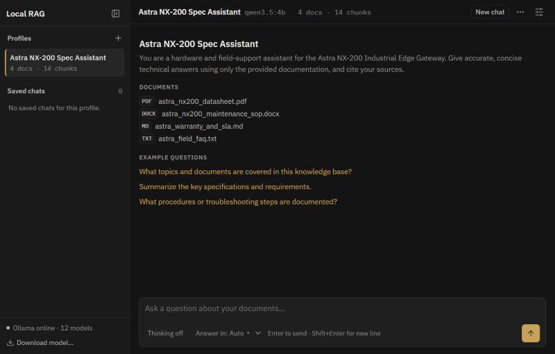
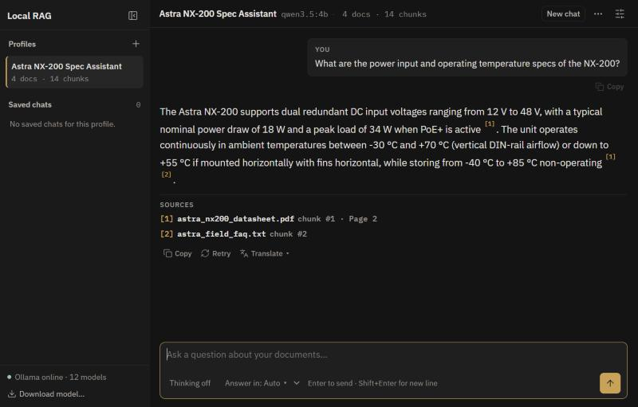
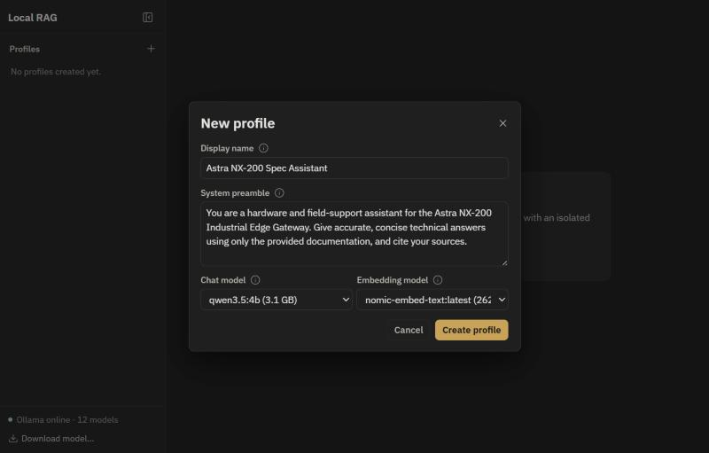
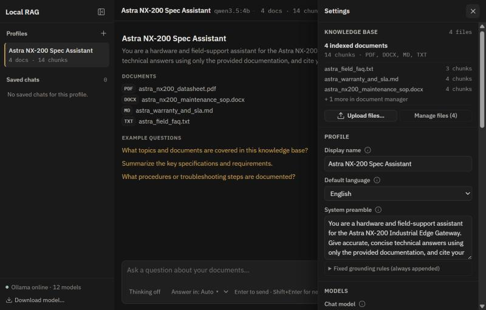
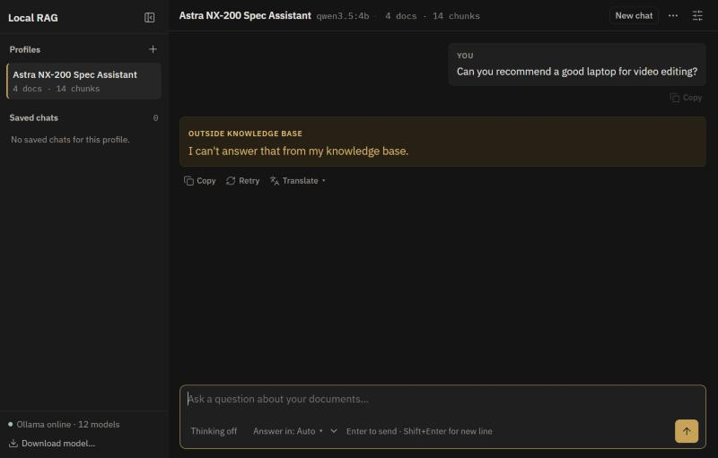
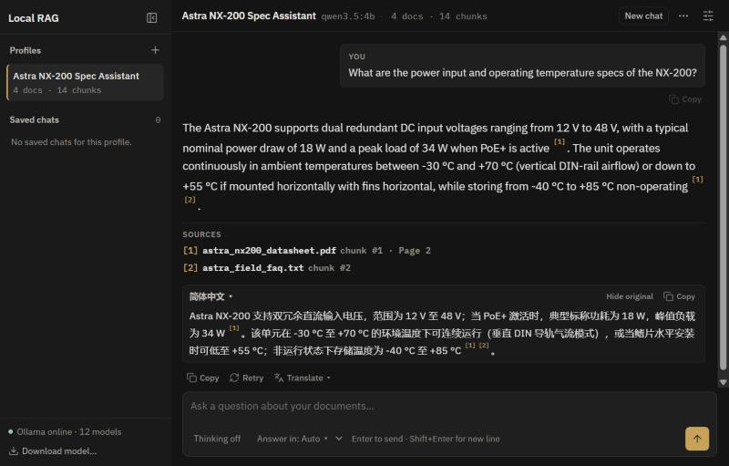

# Local RAG Chatbot

A fully offline chatbot that answers questions from your own documents, using LLMs running locally through [Ollama](https://ollama.com). Nothing leaves your machine.

Create a **bot profile**, give it a persona and upload documents (PDF, DOCX, MD, TXT). The bot answers only from those documents, cites its sources, and refuses when the answer isn't there.



## Features

- **Grounded answers with citations**: every answer links back to the exact passages it used ([how it works](docs/architecture.md#how-a-question-is-answered)).
- **Refuses instead of guessing**: if no document passage is relevant enough, the bot declines before the LLM is called ([threshold setting](docs/configuration.md#profile-settings)).
- **Multiple profiles**: each with its own persona, models, settings and isolated knowledge base.
- **8 languages**: English, Malay, Chinese, Tamil, Indonesian, Japanese, Korean and Arabic, with one-click answer translation ([details](docs/languages.md)).
- **Runs on a laptop**: no dedicated GPU needed (see [Hardware](#hardware)).



## Quick start

Requires Python 3.11+ and [Ollama](https://ollama.com/download).

```powershell
ollama pull qwen3.5:4b
ollama pull nomic-embed-text

python -m venv .venv
.\.venv\Scripts\Activate.ps1        # Linux/macOS: source .venv/bin/activate
pip install -r requirements.txt

python -m app.main
```

Open **http://127.0.0.1:8000**. After setup, no internet connection is needed. Ports, default models and performance options are in [`config.yaml`](config.yaml) (see [Configuration](docs/configuration.md)).

## Try the demo

[`samples/docs/`](samples/docs/) contains a small knowledge base for a fictional industrial gateway, the *Astra NX-200*.

1. Click **+** next to **Profiles**, name the profile and write its preamble.
2. Open **Settings** (top right), click **Upload files…** and select the four files in `samples/docs/`.
3. Ask something like *"What does LED fault code E-409 mean?"*, then try a question the documents don't cover.

| Create a profile | Upload documents and adjust settings |
| :---: | :---: |
|  |  |
| **Out-of-scope questions are refused** | **Translate any answer** |
|  |  |

## Hardware

Developed and tested on an **HP EliteBook 845 G11** running Windows: AMD Ryzen 7 8840U, Radeon 780M integrated graphics, 16 GB RAM, no dedicated GPU. The defaults are chosen for that class of machine: a 4B chat model, and embeddings kept on the CPU so the integrated GPU's shared memory is left for the chat model.

## How it was built

This project was built with AI coding tools, directed by me. I set the requirements and design constraints (fully offline, refusal enforced in code rather than left to the model, built for a laptop without a dedicated GPU), then tested each phase on my own machine before moving on to the next.

- **Claude**: turned the requirements into specifications and implementation prompts, and planned the project structure.
- **Google Antigravity** with **Gemini 4 Argon** and **Gemini 3.8 Flash**: wrote the codebase from those specifications.

Every spec and prompt is kept in [`prompts/`](prompts/README.md), so the full development history can be reviewed.

## Documentation

Start at the [docs index](docs/README.md), or jump to a page:

- [Architecture](docs/architecture.md): how a question is answered, and the project structure
- [Configuration](docs/configuration.md): `config.yaml`, profile settings and performance options
- [Languages](docs/languages.md): language detection and translation
- [API reference](docs/api.md)
- [Testing and evaluation](docs/testing.md): `pytest` (offline) and an accuracy benchmark against the demo documents
- [Development history](prompts/README.md): the spec and prompts behind each phase
