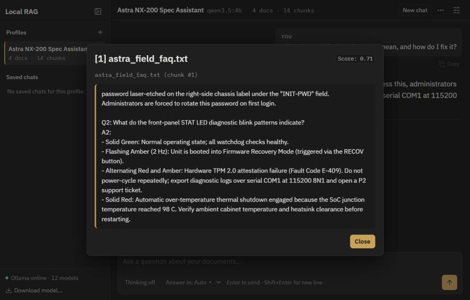

[← README](../README.md) · [Docs](README.md) · **Architecture** · [Configuration](configuration.md) · [Languages](languages.md) · [API reference](api.md) · [Testing](testing.md)

# Architecture

The app is a FastAPI server with a vanilla-JS front end. Ollama runs the models; ChromaDB stores the document vectors. Everything binds to `127.0.0.1`.

```text
Browser UI ──HTTP/SSE──▶ FastAPI (app/main.py)
                              │
                     ChatbotService (core/service.py)
              ┌───────────────┼────────────────┐
         Profiles        RAG engine        Ingestion
       (profiles.py)      (rag.py)       (ingestion.py)
                              │                 │
                      ChromaDB (vectorstore.py) │
                              │                 │
                       Ollama backend (backends/ollama.py)
```

## How a question is answered

1. **Language** – the answer language is resolved first (see [Languages](languages.md)).
2. **Model check** – the profile's chat and embedding models are checked against what Ollama has installed. If the chat model is missing and [`allow_chat_fallback`](configuration.md#configyaml) is on, another installed model is used and the UI shows a banner.
3. **Conversational shortcut** – greetings and "what can you help with?" questions skip retrieval and are answered from the profile's persona and document list.
4. **Retrieval** – the question (plus recent context for short follow-ups) is embedded and the `top_k` closest chunks are fetched from the profile's own Chroma collection ([`top_k`](configuration.md#profile-settings)).
5. **Refusal gate** – if no chunk scores above [`similarity_threshold`](configuration.md#profile-settings), the profile's [refusal message](languages.md#how-the-answer-language-is-chosen) is returned directly. The LLM is never called.
6. **Generation** – otherwise the preamble, retrieved chunks and recent history are sent to the chat model, which streams tokens back. The answer cites chunks as `[1]`, `[2]`, and only the cited chunks are shown as sources.

Clicking a source opens the exact passage that was retrieved, with its similarity score:



## Ingesting documents

Uploaded files are parsed (pypdf, python-docx, plain text), split into overlapping chunks ([`chunk_size` / `chunk_overlap`](configuration.md#profile-settings)), embedded and stored in the profile's collection. Page numbers or headings are kept so citations point to a location. PDFs with no text layer are flagged as scanned and rejected (no OCR).

Changing a profile's embedding model requires re-indexing all of its documents; the UI asks for confirmation first. The ingestion code is tested in [`test_ingestion.py`](../tests/test_ingestion.py), and the HTTP endpoints are listed in the [API reference](api.md).

## Project structure

| Path | Role |
| :--- | :--- |
| [`app/main.py`](../app/main.py) | FastAPI routes and SSE streaming |
| [`app/config.py`](../app/config.py) | Loads `config.yaml` and `data/app_settings.json` |
| [`app/core/service.py`](../app/core/service.py) | Orchestrates profiles, ingestion, chat and translation |
| [`app/core/rag.py`](../app/core/rag.py) | Retrieval, refusal gate, prompt assembly, citations |
| [`app/core/ingestion.py`](../app/core/ingestion.py) | PDF/DOCX/MD/TXT parsing, scanned-PDF check, chunking |
| [`app/core/vectorstore.py`](../app/core/vectorstore.py) | One persistent Chroma collection per profile |
| [`app/core/profiles.py`](../app/core/profiles.py) | Profile, document and saved-chat storage; settings history |
| [`app/core/languages.py`](../app/core/languages.py) | Language detection, precedence rules, translation prompt |
| [`app/core/availability.py`](../app/core/availability.py) | Ollama/model checks, fallback rules, 30 s cache |
| [`app/core/errors.py`](../app/core/errors.py) | Structured error types returned by the API |
| [`app/core/backends/base.py`](../app/core/backends/base.py) | LLM backend interface |
| [`app/core/backends/ollama.py`](../app/core/backends/ollama.py) | Ollama REST implementation |
| [`app/static/`](../app/static/) | Offline UI: `index.html`, `styles.css`, JS modules, bundled fonts |
| `data/` | Runtime storage: profiles, uploaded docs, Chroma (gitignored, see [below](#where-data-is-stored)) |
| [`prompts/`](../prompts/README.md) | Specs and prompts for each development phase |
| [`samples/`](../samples/) | Demo documents and the [evaluation runner](testing.md#evaluation-runner) |
| [`tests/`](../tests/) | Offline pytest suite with a mocked backend ([details](testing.md#unit-tests)) |
| [`config.yaml`](../config.yaml) | Server and default model settings ([details](configuration.md#configyaml)) |

### Front-end modules (`app/static/js/`)

| File | Role |
| :--- | :--- |
| [`main.js`](../app/static/js/main.js) | App start-up and wiring |
| [`chat.js`](../app/static/js/chat.js) | Transcript, streaming, citations, translation popover |
| [`api.js`](../app/static/js/api.js) | Fetch and SSE stream parsing |
| [`settings.js`](../app/static/js/settings.js) | Settings drawer and change history |
| [`documents.js`](../app/static/js/documents.js) | Document manager and uploads |
| [`pullModal.js`](../app/static/js/pullModal.js) | Download a model through Ollama |
| [`banners.js`](../app/static/js/banners.js) | Ollama / model status banners |
| [`infoTips.js`](../app/static/js/infoTips.js) | ⓘ tooltips on settings |
| [`markdown.js`](../app/static/js/markdown.js) | Markdown and citation rendering |
| [`constants.js`](../app/static/js/constants.js), [`state.js`](../app/static/js/state.js), [`dom.js`](../app/static/js/dom.js), [`utils.js`](../app/static/js/utils.js) | Shared constants, state, element refs, helpers |

### Where data is stored

```text
data/
├── app_settings.json          Machine-level overrides set from the UI
├── chroma/                    Vector index for all profiles
└── profiles/<profile-id>/
    ├── profile.json           Preamble, models, retrieval settings, history
    ├── documents.json         Document manifest
    ├── docs/                  Original uploaded files
    └── chats/                 Saved conversations
```

---

[← README](../README.md) · [Docs](README.md) · **Architecture** · [Configuration](configuration.md) · [Languages](languages.md) · [API reference](api.md) · [Testing](testing.md)
