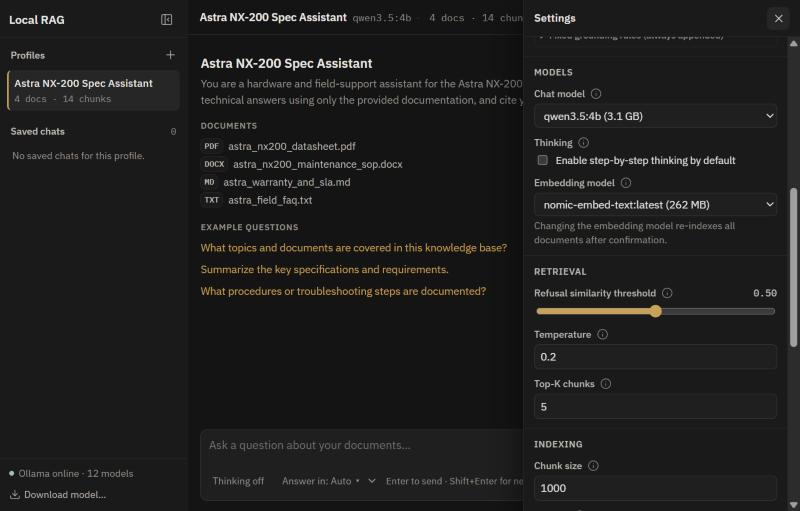

[← README](../README.md) · [Docs](README.md) · [Architecture](architecture.md) · **Configuration** · [Languages](languages.md) · [API reference](api.md) · [Testing](testing.md)

# Configuration

There are two levels of settings: **machine settings** in `config.yaml`, and **profile settings** stored per profile and edited in the app's Settings panel.

## `config.yaml`

The file is [`config.yaml`](../config.yaml) in the project root; it is loaded by [`app/config.py`](../app/config.py).

```yaml
host: "127.0.0.1"                 # Must stay 127.0.0.1; any other value is rejected
port: 8000
data_dir: "data"                  # Profiles, uploaded documents and the vector index

ollama_base_url: "http://127.0.0.1:11434"
default_chat_model: "qwen3.5:4b"
default_embedding_model: "nomic-embed-text"
allow_chat_fallback: true         # Use another installed chat model if the profile's is missing
model_cache_ttl_seconds: 30       # How long Ollama model checks are cached

embedding_device: "cpu"           # "cpu" or "auto"
keep_alive: "30m"                 # How long Ollama keeps models loaded between requests
```

Changing the embedding device in the UI writes to `data/app_settings.json`, which overrides `config.yaml` without editing it.

## Profile settings

| Setting | Default | Range | What it does |
| :--- | :--- | :--- | :--- |
| `preamble` | – | – | System prompt: the bot's role, tone and rules |
| `chat_model` | `default_chat_model` | – | Ollama model that writes the answer |
| `embedding_model` | `default_embedding_model` | – | Ollama model that indexes documents. Changing it re-indexes the profile |
| `temperature` | 0.2 | 0–2 | Higher is more varied, lower is more literal |
| `top_k` | 5 | 1–25 | Number of chunks retrieved per question |
| `similarity_threshold` | 0.5 | 0–1 | Minimum chunk score needed to answer; below it the bot [refuses](architecture.md#how-a-question-is-answered) |
| `chunk_size` | 1000 | 100–8000 | Characters per chunk. Applies to documents uploaded afterwards* |
| `chunk_overlap` | 150 | < `chunk_size` | Characters shared between neighbouring chunks* |
| `history_turns` | 4 | 0–20 | Previous turns sent with each question |
| `enable_thinking` | off | – | Lets reasoning models think before answering (slower) |
| `default_language` | `en` | – | Answer language when nothing else decides it ([precedence](languages.md#how-the-answer-language-is-chosen)) |
| `refusal_messages` | built-in | – | Refusal text per language (see [Languages](languages.md)) |

\* To apply new chunk settings to documents already uploaded, call [`POST /api/profiles/{id}/reindex`](api.md#profiles) (there is no re-index button in the UI yet).

The Settings panel keeps a short history of changes to each profile, and every setting has an ⓘ tooltip.



### Tuning tips

- **Too many refusals:** lower `similarity_threshold` or raise `top_k`. Scores differ between embedding models, so re-check the threshold after switching models. The [evaluation runner](testing.md#evaluation-runner) can compare thresholds and models (`--threshold`, `--embedding-model`).
- **Answers mixing up unrelated passages:** raise the threshold or lower `top_k`.
- **Tables or long procedures split badly:** increase `chunk_size`, then re-index (see above).

## Performance

**Embedding on CPU.** With `embedding_device: "cpu"` the app sends `num_gpu: 0` with embedding requests, so the embedding model stays off the GPU and its memory is left for the chat model. This matters on integrated graphics with shared memory. Switching between CPU and Auto doesn't require re-indexing.

**Keep-alive.** `keep_alive` stops Ollama unloading models between questions, so only the first question after start-up pays the load time.

**Debug mode.** The Debug toggle in the toolbar shows, per answer: query embedding time, retrieval time, time to first token, total time, tokens per second and token counts, plus every retrieved chunk with its score (not only the cited ones).

### Reference hardware

Developed and tested on an HP EliteBook 845 G11 (AMD Ryzen 7 8840U, Radeon 780M integrated graphics, 16 GB RAM) with `qwen3.5:4b` for chat and `nomic-embed-text` on CPU for embeddings.

---

[← README](../README.md) · [Docs](README.md) · [Architecture](architecture.md) · **Configuration** · [Languages](languages.md) · [API reference](api.md) · [Testing](testing.md)
