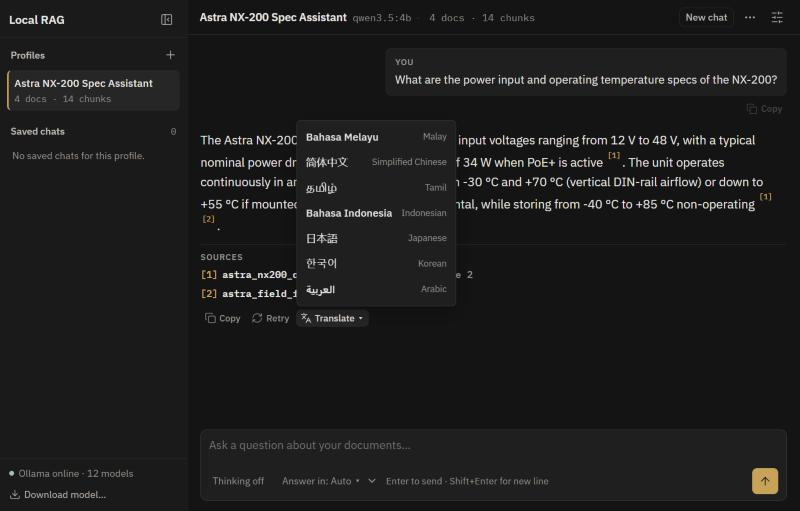

[← README](../README.md) · [Docs](README.md) · [Architecture](architecture.md) · [Configuration](configuration.md) · **Languages** · [API reference](api.md) · [Testing](testing.md)

# Languages

The bot can answer in eight languages and translate any answer into the others. Detection runs offline with [Lingua](https://github.com/pemistahl/lingua-py).

| Code | Language | Native name |
| :--- | :--- | :--- |
| `en` | English | English |
| `ms` | Malay | Bahasa Melayu |
| `zh` | Simplified Chinese | 简体中文 |
| `ta` | Tamil | தமிழ் |
| `id` | Indonesian | Bahasa Indonesia |
| `ja` | Japanese | 日本語 |
| `ko` | Korean | 한국어 |
| `ar` | Arabic | العربية |

## How the answer language is chosen

The first rule that applies wins:

1. **"Answer in" selector** in the message box, if set to a language.
2. **A request in the message**, e.g. *"answer in Malay"*, *"jawab dalam bahasa melayu"*, *"用中文回答"*.
3. **Detected language** of the message, if it has at least 3 words and detection confidence is at least 0.35. When Malay and Indonesian score close together, Malay is preferred.
4. **Previous message** in the chat, otherwise the profile's `default_language`.

Refusals use the profile's [refusal message](configuration.md#profile-settings) for the chosen language. The rules live in [`app/core/languages.py`](../app/core/languages.py) and are tested in [`test_multilingual.py`](../tests/test_multilingual.py).

## Translating an answer

**Translate ▾** under an answer rewrites it in another language using [`POST /api/translate`](api.md#post-apitranslate). The translation:

- skips retrieval and goes straight to the chat model (temperature 0.1, thinking off);
- keeps citation markers, numbers, units and model names unchanged;
- appears inside the same message, under the original (which can be hidden), and is cached so switching languages back is instant.

## Embedding model choice

`nomic-embed-text` is trained mainly on English. For documents or questions in other languages, a multilingual embedding model such as `bge-m3` usually retrieves better. Compare both on your own documents with the [evaluation runner](testing.md).

---

[← README](../README.md) · [Docs](README.md) · [Architecture](architecture.md) · [Configuration](configuration.md) · **Languages** · [API reference](api.md) · [Testing](testing.md)
