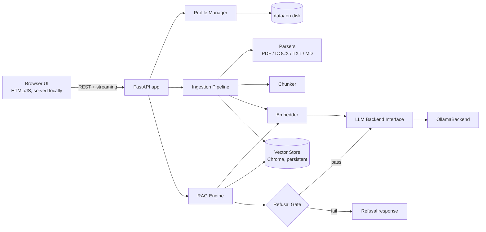

# Local RAG Chatbot — Project Specification

> **Instructions for the coding agent:** Build **Phase 1 only** unless told otherwise. Phases 2 and 3 are described so the Phase 1 architecture leaves room for them. Do not build them early. If a requirement here conflicts with a technical constraint you discover, stop and ask rather than silently deviating.

---

## 1. Purpose and context

A chatbot that runs entirely on a local laptop and answers questions **only from a user-supplied knowledge base**. It is topic-agnostic. Each "bot profile" pairs a user-written preamble (system prompt) with its own set of documents, so the same app can act as a product-spec assistant, a training-material Q&A, or anything else.

- **Primary use:** internal office tool. The first milestone is a working demo to present to a manager.
- **Later use:** cleaned up and published as a GitHub portfolio project.
- **Hard requirement:** works offline after initial setup. No document content, prompts, or answers leave the machine.

## 2. Scope

### In scope (Phase 1)
- Create, edit, delete, and switch between bot profiles
- Upload PDF, DOCX, TXT, and MD files to a profile's knowledge base, and remove them again
- Retrieval-augmented answers with citations to source file and page/section
- Refusal, enforced in code, when the knowledge base doesn't cover the question
- Streaming responses in a browser UI
- Ollama as the LLM and embedding backend

### Non-goals (do not build)
- User accounts, authentication, multi-user access
- Network exposure beyond `127.0.0.1`
- OCR for scanned PDFs, images, or spreadsheets
- Cloud APIs of any kind
- Fine-tuning or model training
- Answering from the model's general knowledge (see §4.3)

## 3. Architecture



**Design rule:** all business logic lives in Python modules that don't depend on FastAPI. The API layer is thin. This lets a CLI, a desktop wrapper, or the Phase 3 device simulator reuse the core without rewrites.

## 4. Components

### 4.1 Bot profiles
Each profile is stored as JSON at `data/profiles/<profile_id>/profile.json`, with its uploaded files in `data/profiles/<profile_id>/docs/` and its own vector collection.

| Field | Type | Default | Notes |
|---|---|---|---|
| `id` | str | generated slug | |
| `name` | str | — | Display name |
| `preamble` | str | — | User-written system prompt: persona, tone, topic |
| `chat_model` | str | from config | Ollama model tag |
| `embedding_model` | str | `nomic-embed-text` | **Changing this triggers a full re-index.** The model name and vector dimension are also stored in the collection's metadata (see §4.7) |
| `temperature` | float | 0.2 | Low by default; this is a factual tool |
| `top_k` | int | 5 | Chunks retrieved per query |
| `similarity_threshold` | float | 0.5 | Refusal gate cutoff; must be tunable in the UI |
| `refusal_message` | str | see §4.3 | |
| `chunk_size` / `chunk_overlap` | int | 1000 / 150 chars | |
| `history_turns` | int | 4 | Prior turns sent to the LLM |

### 4.2 Ingestion pipeline
1. **Parse**
   - PDF via `pypdf`, keeping the page number per chunk. Avoid PyMuPDF because its AGPL licence is a problem for later GitHub publication.
   - DOCX via `python-docx`, keeping the heading as the section label.
   - TXT/MD read directly.
   - If a PDF yields little or no text, flag it in the UI as "likely scanned, not supported" instead of indexing nothing silently.
2. **Chunk:** recursive character splitting, preferring paragraph and sentence boundaries.
3. **Embed** via the backend's `embed()` method.
4. **Store** in a persistent Chroma collection, one per profile. Metadata per chunk: `source_file`, `page` or `section`, `chunk_index`, `file_hash`.
5. **Dedupe:** re-uploading the same file (same hash) is a no-op. Deleting a file removes its chunks.

Scale target: up to ~100 pages per profile. Ingesting that should finish in under 2 minutes on the baseline hardware (§6).

### 4.3 RAG engine and refusal gate
**Query flow:**
1. Build a retrieval query from the latest user message. If it's short or contains pronouns ("what about its warranty?"), append the previous user message. Keep this simple and do not use an LLM rewrite in Phase 1.
2. Retrieve `top_k` chunks and convert Chroma distances to similarity scores (0–1).
3. **Refusal gate (in code, before any LLM call):** if no chunk scores at or above `similarity_threshold`, return `refusal_message` immediately, with the reason ("No relevant content found in this bot's knowledge base. Best match scored 0.31, threshold is 0.50.").
4. Otherwise, send the LLM this context:
   - **System:** preamble, plus fixed grounding rules (below)
   - **Context block:** numbered chunks with source labels
   - **History:** last `history_turns` turns
   - **Question**
5. Stream the answer back, followed by a sources list mapping `[1]`, `[2]`, etc. to file and page.

**Fixed grounding rules,** appended to every preamble and not editable by the user:
> Answer only using the numbered context passages. Cite passages as [n]. If the passages do not contain the answer, reply exactly with the refusal message and briefly state what information is missing. Do not use outside knowledge.

**Why the gate is in code:** small local models (around 4B) frequently ignore "say you don't know" instructions and answer from general knowledge. The threshold gate is the primary defence; the prompt rule is secondary.

**Default refusal message:** "I can't answer that from my knowledge base." followed by the reason.

### 4.4 LLM backend interface
Define an abstract base class so other local platforms can be added later without touching the RAG engine:

```python
class LLMBackend(ABC):
    def list_models(self) -> list[str]: ...
    def chat(self, messages: list[dict], model: str, options: dict, stream: bool) -> Iterator[str]: ...
    def embed(self, texts: list[str], model: str) -> list[list[float]]: ...
    def model_info(self, model: str) -> dict: ...  # size on disk, params, quantization, capabilities; size needed for Phase 3
    def pull_model(self, model: str) -> Iterator[dict]: ...  # download with progress events; user-initiated only
```

`list_models()` must return each model's **capabilities** (`completion` and/or `embedding`, from Ollama's `/api/show`). If the installed Ollama version doesn't report capabilities, fall back to a name heuristic (tags containing `embed`, `bge`, `e5`, `minilm` are embedding models) and mark the result as "unverified" in the UI.

Phase 1 implements `OllamaBackend` using Ollama's local REST API (`/api/chat`, `/api/embed`, `/api/tags`, `/api/show`). The backend URL comes from config, defaulting to `http://127.0.0.1:11434`. `options` passes through Ollama runtime options (`num_ctx`, `num_thread`, `num_gpu`, `temperature`). Phase 3 depends on this passthrough.

### 4.5 Web UI
Plain HTML, CSS, and vanilla JS served by FastAPI from `/static`. **All assets must be local; no CDNs**, because the app has to work offline.

The page has three areas:
- **Sidebar:** profile list, plus a "New profile" button
- **Main:** chat window with streaming output and clickable citations that show the source chunk text
- **Settings panel:** edit the preamble and the §4.1 fields. **Model selection uses dropdowns, not free text:** the chat model dropdown lists only installed models with `completion` capability, and the embedding model dropdown lists only installed models with `embedding` capability. Each entry shows its size on disk. Changing the embedding model opens a confirmation dialog stating that the knowledge base will be re-indexed and roughly how many chunks are involved; nothing changes until the user confirms. The panel also manages documents (upload, list, delete, ingestion status), and a **debug toggle** that shows the retrieved chunks and similarity scores for each answer. This is essential for tuning the threshold and useful in the demo.

Also needed: a clear-conversation button, and a status indicator showing whether Ollama is reachable and which model is loaded.

### 4.6 API endpoints

| Method | Path | Purpose |
|---|---|---|
| GET | `/api/health` | App and Ollama status |
| GET | `/api/models` | Installed models with capabilities and size |
| POST | `/api/models/pull` | Download a model (streams progress); requires explicit user action in the UI |
| GET/POST | `/api/profiles` | List / create profiles |
| GET/PUT/DELETE | `/api/profiles/{id}` | Read / update / delete a profile |
| POST | `/api/profiles/{id}/documents` | Upload and ingest (multipart) |
| GET | `/api/profiles/{id}/documents` | List documents with chunk counts |
| DELETE | `/api/profiles/{id}/documents/{doc_id}` | Remove a document and its chunks |
| POST | `/api/profiles/{id}/chat` | Send a message; streams the response (SSE or chunked) |

Conversation history is held in memory per browser session for Phase 1. Persistence is not required.

### 4.7 Model availability and fallbacks
Profiles can reference models that aren't installed: a model was deleted, a profile was copied to a colleague's laptop, or Ollama was reinstalled. The app must detect this and never fail with a raw backend error.

**When checks run:** at startup, when a profile is opened, before each chat request (using a cached model list, refreshed at most every 30 seconds), and before ingestion.

| Situation | Behaviour |
|---|---|
| Ollama not running | Global banner: "Ollama is not reachable at <url>. Start Ollama and click Retry." Chat and upload are disabled. No crash. |
| No models installed at all | First-run screen with the exact `ollama pull` commands for the recommended defaults, plus a Retry button. |
| **Chat model** not installed | Profile shows a warning badge. If `allow_chat_fallback` is true in config **and** `default_chat_model` is installed, chat proceeds with the fallback and a persistent banner states: "Using <fallback> because <model> is not installed." Otherwise chat is blocked with three options: pick an installed model, download the missing one, or cancel. **Never substitute silently.** |
| **Embedding model** not installed | **No fallback.** Vectors from different embedding models are incompatible, so retrieval would return garbage. Chat and upload are blocked. Options: download the missing model, or switch to an installed embedding model (which triggers the re-index confirmation from §4.5). |
| Embedding model or dimension doesn't match the collection's stored metadata | Same as above: block and offer a re-index. Prevents silent retrieval corruption if a profile file was edited by hand. |
| Model installed but fails to load (e.g. out of memory) | Catch the backend error and show: "<model> failed to load, likely insufficient memory. Try a smaller model." Include the backend's error text under an expandable "details" section. |

**Downloads:**
- Never automatic. Each download requires a click and a confirmation showing the model name and approximate size.
- Shows a progress bar and can be cancelled.
- Fails gracefully with "No internet connection; download unavailable offline" when there's no network. This is the only feature that needs internet, and it's acceptable because it's an explicit, user-initiated setup action.

**Config additions** (`config.yaml`):
```yaml
default_chat_model: "<installed Qwen 4B tag>"
default_embedding_model: "nomic-embed-text"
allow_chat_fallback: true
```

## 5. Project structure

```
local-rag-chatbot/
├── app/
│   ├── main.py              # FastAPI app, routes only
│   ├── config.py            # loads config.yaml
│   ├── core/
│   │   ├── profiles.py
│   │   ├── ingestion.py     # parsers + chunker
│   │   ├── vectorstore.py
│   │   ├── rag.py           # retrieval, gate, prompt assembly
│   │   └── backends/
│   │       ├── base.py
│   │       └── ollama.py
│   └── static/              # index.html, app.js, styles.css
├── data/                    # gitignored; profiles, docs, vector DB
├── tests/
├── samples/                 # demo knowledge base + eval questions
├── config.yaml
├── requirements.txt
└── README.md
```

## 6. Tech stack and constraints

- **Python** 3.11+, FastAPI, Uvicorn, `httpx`, ChromaDB (persistent client with `anonymized_telemetry=False`), `pypdf`, `python-docx`, `pytest`
- **Server binds to `127.0.0.1` only.** It must never be reachable from the network.
- **Baseline hardware:** HP EliteBook, AMD Ryzen 7 8840U, Radeon 780M iGPU, 16 GB RAM. A Qwen 4B model runs on the iGPU; 9B runs on CPU only. Default the chat model to the installed Qwen 4B, configurable.
- **Target deployment:** colleagues' laptops are 1–2 CPU generations older with at least 16 GB RAM and iGPUs. Keep the default footprint modest.
- **OS:** assume Windows 11 as primary, but avoid OS-specific code so it also runs on Linux.
- **Setup:** documented in the README in under 10 steps: install Ollama, pull models, create a venv, `pip install`, run.

## 7. Phases and acceptance criteria

### Phase 1: core and demo
Done when **all** of these hold:
1. A new profile can be created with a preamble, given 3+ mixed-format documents, and queried from the browser.
2. In-scope questions return grounded answers with correct citations (file + page).
3. Out-of-scope questions are refused with the reason. The LLM is not called when the gate fails; verify by test or log.
4. Switching profiles fully isolates knowledge bases: profile A never retrieves profile B's chunks.
5. The app works with networking disabled after setup.
6. `samples/` contains a demo knowledge base with ~10 in-scope and ~5 out-of-scope test questions, plus a script that runs them and reports pass/fail and refusal accuracy.
7. Unit tests cover chunking, the refusal gate, profile CRUD, and document deletion.
8. Chat and embedding models can each be chosen per profile from dropdowns that show only installed models of the correct type. Two profiles using different chat models both work.
9. Every row of the §4.7 table is handled as specified. Verify with tests that mock the backend: Ollama down, chat model missing (fallback on and off), embedding model missing, metadata mismatch, load failure. None of these produce a stack trace or a raw error in the UI.
10. Changing a profile's embedding model requires confirmation and results in a complete re-index; retrieval works afterwards.

### Phase 2: additional backends
- Add `OpenAICompatibleBackend`, covering LM Studio, llama.cpp server, and vLLM, which all expose OpenAI-compatible endpoints.
- Backend is selectable per profile, or globally in config.
- **Done when:** the same profile gives answers through Ollama and LM Studio with no changes to RAG code.

### Phase 3: device profiles (hardware simulation)
Lets the user approximate how the chatbot would behave on weaker hardware, such as an older office laptop or a tablet.

**Hard limit, to be stated in the UI:** this can only simulate hardware *weaker* than the host. It approximates whether a model fits and roughly how fast it feels. It does not reproduce another device's CPU, GPU, or NPU behaviour.

A device profile has these fields:

| Field | Effect |
|---|---|
| `max_model_ram_gb` | Fit check: blocks models whose size (from `model_info`) plus a KV-cache estimate exceeds the budget |
| `num_ctx` | Caps the context window |
| `num_thread` | Limits CPU threads |
| `gpu_enabled` | `false` sets `num_gpu=0` (CPU only) |
| `target_tokens_per_sec` | Optional: throttles streamed output to the target rate. Values come from published benchmarks or manual measurement |

- Ship presets: "Host (no limits)" and "Office laptop (approx.)". Users can add their own.
- Show measured tokens/sec and time-to-first-token after each answer.
- **Done when:** selecting a device profile visibly changes allowed models, speed, and context limits, and a warning appears when a model won't fit.

## 8. Open questions (decide later, not blocking Phase 1)
- Persisting conversation history across sessions
- Whether to add LLM-based query rewriting if the simple follow-up handling (§4.3 step 1) proves inadequate
- Re-ranking retrieved chunks if retrieval quality is weak
- Packaging for colleagues (installer vs. README setup)
- Default `similarity_threshold`: 0.5 is a placeholder and must be calibrated against the sample eval set
